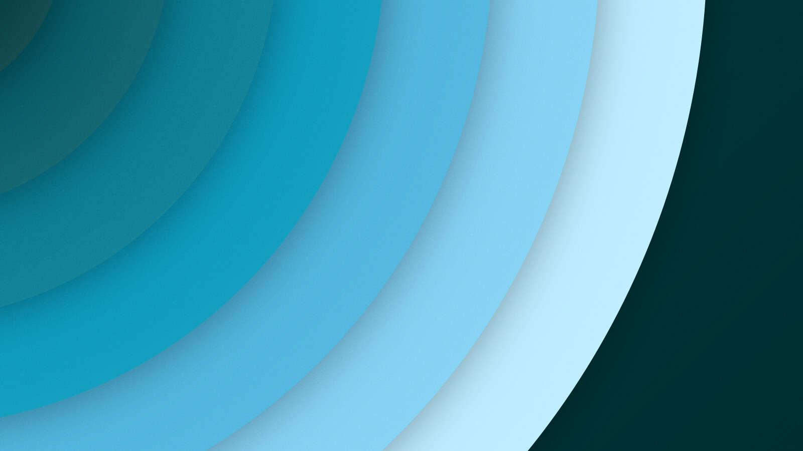
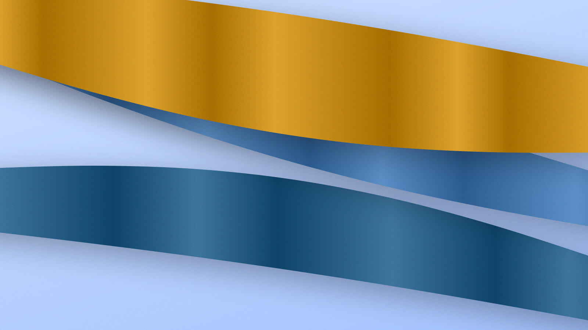
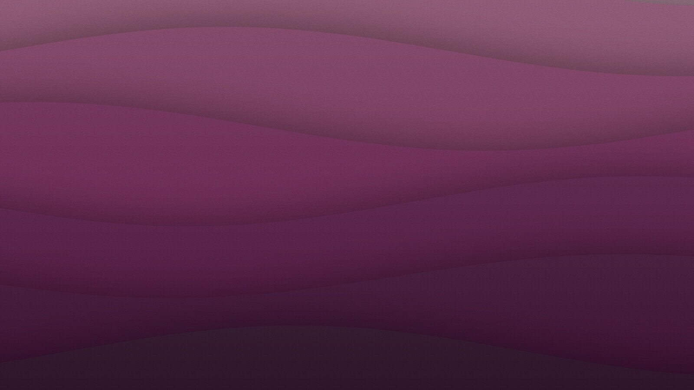

<h1 align="center">Prospekt</h1>

<p align="center"><strong>Procedural backgrounds that look designed.</strong></p>

<p align="center">
  A small Rust library that draws calm, abstract backgrounds with Cairo: layered paper,
  concentric arcs, silk ribbons, folded planes, line bundles, soft mist, paper-cut contours, organic blobs, mesh gradients, low-poly facets, Bauhaus geometry and classic waves.
  It is the generator behind Kulisse (a wallpaper app, not public yet)
  and <a href="https://github.com/linuxundich/ScreenForge">ScreenForge</a> (screenshot compositions).
</p>

<p align="center">
  
  
  
</p>

<p align="center"><sub>Arcs (seed 2026), ribbons (seed 7) and layers in the dark mood (seed 1337), rendered with <code>cargo run --release --example showcase</code>.</sub></p>

A *Prospekt* is the painted backdrop at the back of a theatre stage.

## How it works

A `GeneratedBackground` holds only inputs: a seed, a style, a palette and a handful of `0.0..=1.0` knobs (density, flow, variation, contrast, softness, grain, zoom, offset). `render` turns them into vector drawing on any Cairo context. The same inputs always give the same picture, at any size from a thumbnail to 8K, so storing those few hundred bytes is enough to get a background back exactly.

- Palettes are built in Oklab: mood ramps (vivid, light, dark) around a random or chosen hue, grayscale, or colors taken from images.
- Soft shadows from one light direction and gentle gradients give depth.
- `variant` derives any number of alternatives from one background.
- Regions can be kept clear, so a composition's content doesn't sit on the busiest part.
- No GTK dependency.

## Use

```toml
[dependencies]
prospekt = { git = "https://github.com/linuxundich/prospekt", tag = "v0.4.0" }
```

```rust
use cairo::{Context, Format, ImageSurface};
use prospekt::{palette, GeneratedBackground, GeneratorStyle, Mood};

let mut bg = GeneratedBackground { style: GeneratorStyle::Arcs, mood: Mood::Dark, ..GeneratedBackground::new(42) };
bg.palette = palette::mood_palette(bg.seed, bg.mood, None, 1.0);

let surface = ImageSurface::create(Format::ARgb32, 3840, 2160)?;
prospekt::render(&Context::new(&surface)?, &bg, 3840.0, 2160.0, &[])?;
```

## Stability

Every background carries the algorithm `version` it was made with. A change that would alter how saved backgrounds look only applies from a new version on: saved scenes keep their pixels, and `GeneratedBackground::new` gives new backgrounds the latest version. Data saved before the field existed loads as version 1.

A golden test pins the exact pixels of 189 backgrounds: 126 of version 1, rendered by ScreenForge 0.34.0, what version 2 changed, and every style added since. GitHub Actions runs it on every push, there with a small tolerance for the edge anti-aliasing of older Cairo and Pixman versions. A failure means a saved look would change, so a new version is due instead.

```sh
cargo test                                   # includes the golden test
PROSPEKT_BLESS=1 cargo test --test golden     # rewrite after an intended change
cargo run --release --example timing         # render times per style
cargo run --release --example showcase DIR   # the README pictures as PNG
```

## License

GPL-3.0-or-later
